<!-- BBN:HEADER:START -->
<div align="center">



<a href="https://github.com/Boom-Vitt/openclaw-antigravity-RAG/stargazers"></a>
<a href="https://github.com/Boom-Vitt/openclaw-antigravity-RAG/commits/main"></a>
<a href="https://github.com/Boom-Vitt"></a>

</div>
<!-- BBN:HEADER:END -->

# openclaw-RAG

> Thai-language legal document embedding and RAG (Retrieval-Augmented Generation) system

A fully client-side web application for uploading Thai documents, generating vector embeddings via [phaya.io](https://phaya.io), and saving them to Supabase for semantic search.

## Features

- 📄 Upload `.txt` or `.docx` Thai documents
- ✂️ Automatic text chunking (configurable size + overlap)
- 🤖 Embedding via **phaya.io** — Qwen3 Embedding 8B (4096 dimensions)
- 🗄️ Storage in **Supabase** (PostgreSQL + pgvector)
- 💬 RAG chat page — semantic search over stored chunks
- 🌐 Pure static frontend — no backend required

## Pages

| File | Purpose |
|------|---------|
| `index.html` | Upload documents & generate embeddings |
| `chat.html` | Ask questions via RAG semantic search |

## Setup

1. Update `config.js` with your credentials:
   - `defaultApiKey` — your phaya.io API key
   - `supabaseUrl` + `supabaseAnonKey` — your Supabase project

2. Deploy to any static host (Hostinger, Netlify, Vercel, GitHub Pages)

3. *(Optional)* Upload pre-embedded documents using the Node.js script:
   ```bash
   node upload_embeddings.mjs your-document.txt
   ```

## Supabase Schema

```sql
-- Enable pgvector
create extension if not exists vector;

-- Documents table
create table documents (
  id uuid primary key default gen_random_uuid(),
  title text, source_file text, content text,
  file_type text, char_count int, metadata jsonb,
  created_at timestamptz default now()
);

-- Chunks table (4096-dim embeddings)
create table chunks (
  id uuid primary key default gen_random_uuid(),
  document_id uuid references documents(id) on delete cascade,
  chunk_index int, content text,
  embedding vector(4096), token_count int,
  created_at timestamptz default now()
);

-- Similarity search function
create or replace function match_chunks(
  query_embedding vector(4096),
  match_threshold float,
  match_count int
) returns table(id uuid, content text, similarity float) ...
```

## Tech Stack

- **Frontend:** Vanilla HTML/CSS/JS
- **Embedding:** phaya.io (Qwen3 8B, 4096 dims)
- **Vector DB:** Supabase + pgvector
- **Word extraction:** mammoth.js (for .docx)
- **Upload script:** Node.js 18+ (zero dependencies)

## License

MIT

<!-- BBN:FOOTER:START -->
---

<div align="center">

**สร้างโดย [BoomBigNose](https://github.com/Boom-Vitt)** · [Kruoop.com](https://kruoop.com) แหล่งเรียน AI + คอมมูนิตี้ · [Seeneo.ai](https://seeneo.ai) · [YouTube 220K](https://www.youtube.com/@BoomBigNose)

<sub>ถ้าโปรเจกต์นี้มีประโยชน์ กด ⭐ ให้กำลังใจกันได้เลย</sub>

</div>
<!-- BBN:FOOTER:END -->
